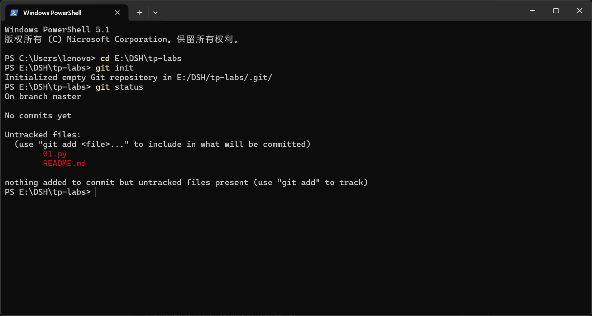
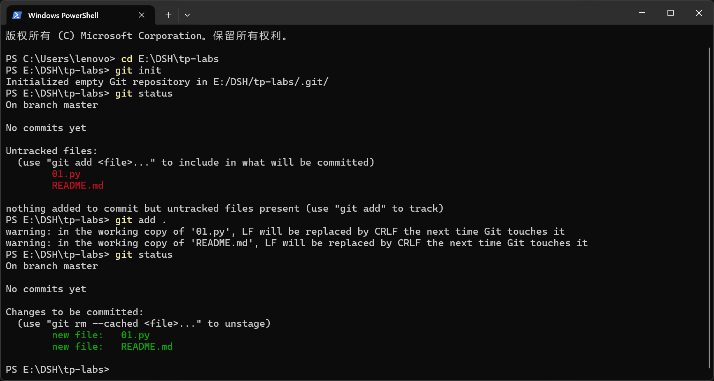
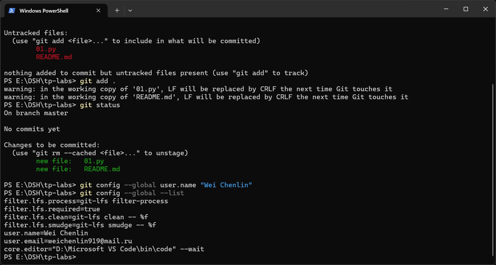
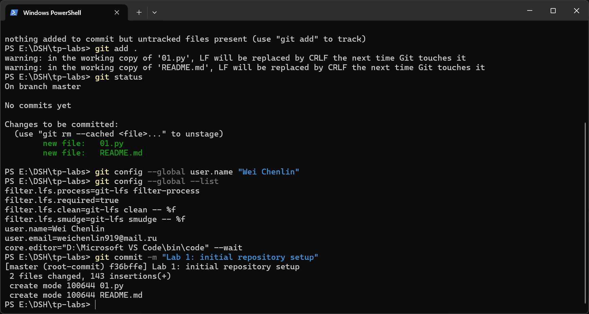
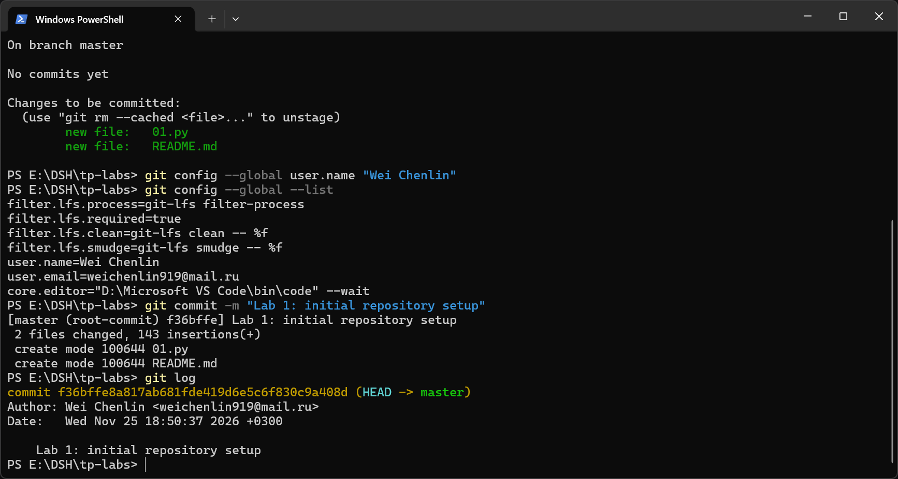
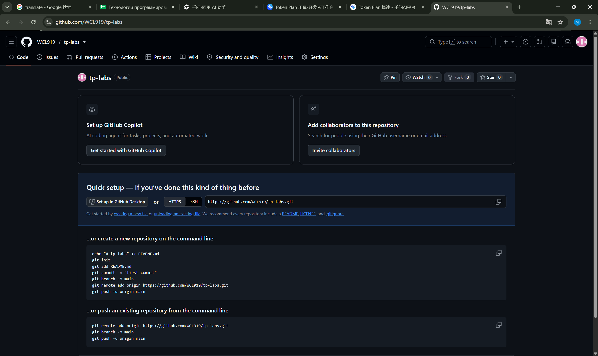
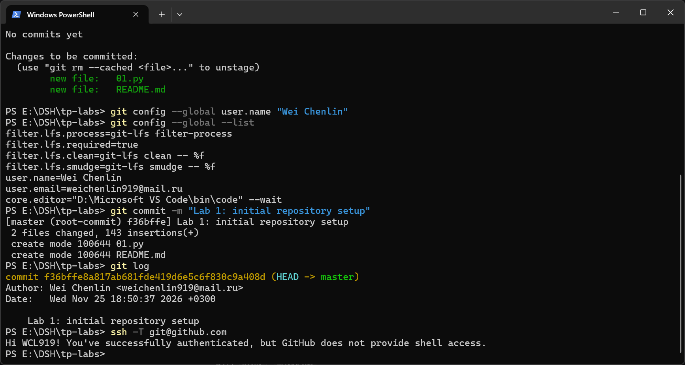
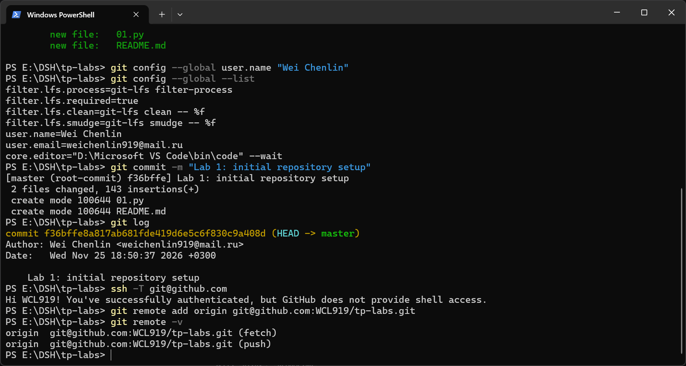
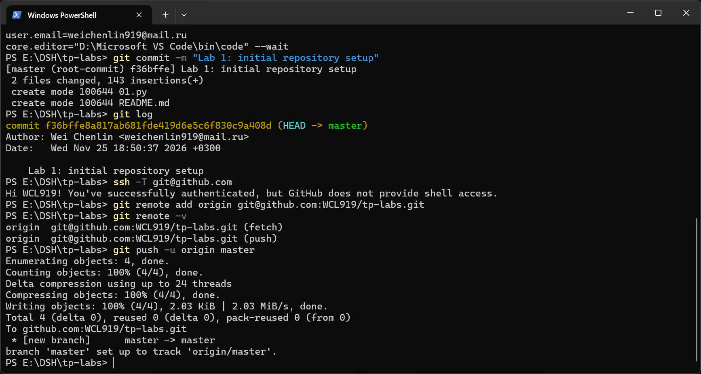

# Лабораторная работа №1 — Git

## Что надо было сделать

1. Создать репозиторий
2. Сделать коммит
3. Добавить удалённый репозиторий
4. Запушить локальные коммиты на GitHub

## Как делал

### 1. Создал репозиторий

```bash
git init
git status
```



Сразу видно, что файлы в состоянии *untracked*: Git про них знает, но в
коммит они пока не попадут.

### 2. Сделал первый коммит

Добавил файлы в индекс:

```bash
git add .
git status
```



После `add` файлы переехали в `Changes to be committed`. Между рабочей
папкой и коммитом появилась прослойка — индекс, — и в снимок попадёт
только то, что я туда положил.

Указал, кто автор изменений:

```bash
git config --global user.name "Wei Chenlin"
git config --global --list
```



Сам коммит:

```bash
git commit -m "Lab 1: initial repository setup"
```



Проверил, что он появился в истории:

```bash
git log
```



### 3. Создал репозиторий на GitHub

Создал пустой репозиторий, без README и .gitignore — иначе при первом
пуше получился бы конфликт.



Проверил, что SSH работает:

```bash
ssh -T git@github.com
```



Привязал удалённый репозиторий:

```bash
git remote add origin git@github.com:WCL919/tp-labs.git
git remote -v
```



### 4. Запушил коммиты

```bash
git push -u origin master
```



Флаг `-u` запоминает, что локальная ветка `master` связана с удалённой,
поэтому дальше хватает просто `git push`.

## Итог

Разобрался с базовым циклом Git: `init` создаёт репозиторий, `add` готовит
файлы к коммиту, `commit` делает снимок, `remote add` привязывает GitHub,
`push` отправляет коммиты на сервер. Главное, что понял: между рабочей
папкой и коммитом есть индекс, и именно он решает, что попадёт в снимок.
Отчёт лежит в том же репозитории рядом с кодом, поэтому открывается
прямо на GitHub.
