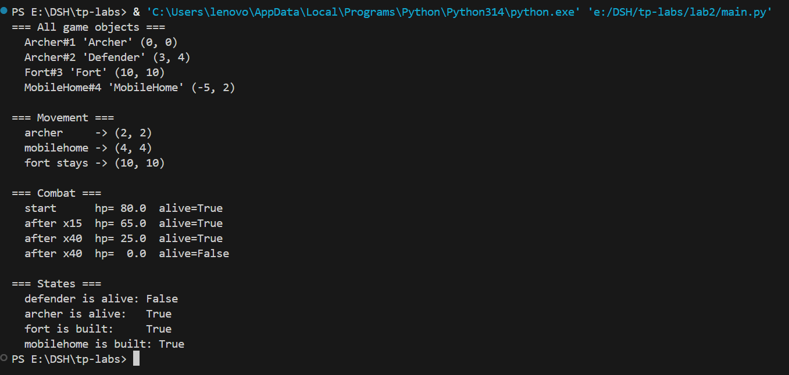

# Лабораторная работа №2 — Основы ООП

## Что надо было сделать

По готовой диаграмме написать классы для пошаговой стратегии: базовый
`GameObject`, от него `Building` и `Unit`, от них `Fort`, `MobileHome` и
`Archer`. Плюс два интерфейса — `Attacker` и `Moveable`. Какие классы
делать абстрактными, решаю сам.

## Что получилось

```text
GameObject
|-- Building
|   |-- Fort        -> Attacker
|   `-- MobileHome  -> Moveable
`-- Unit
    `-- Archer      -> Attacker, Moveable
```

## Кто что умеет

| Класс | Что это | От кого | Что реализует | Методы |
| --- | --- | --- | --- | --- |
| `GameObject` | всё сразу | — | — | `getId`, `getName`, `getX`, `getY` |
| `Unit` | юнит | `GameObject` | — | `isAlive`, `getHp`, `receiveDamage` |
| `Building` | постройка | `GameObject` | — | `isBuilt` |
| `Attacker` | интерфейс | — | — | `attack(unit)` |
| `Moveable` | интерфейс | — | — | `moveTo(x, y)` |
| `Archer` | лучник | `Unit` | `Attacker`, `Moveable` | `attack`, `moveTo` |
| `Fort` | крепость | `Building` | `Attacker` | `attack` |
| `MobileHome` | дом на колёсах | `Building` | `Moveable` | `moveTo` |

Писал на Python. Интерфейсы там делаются через модуль `abc`: класс, у которого
все методы помечены `@abstractmethod`, — это и есть интерфейс.

## Почему именно так

**Идентификатор, имя и координаты лежат в `GameObject`.** Они нужны любому
объекту на карте. Если бы я не вынес их в базовый класс, пришлось бы писать
одни и те же поля четыре раза — в `Unit`, `Building`, `Fort` и так далее.

**`Unit` и `Building` абстрактные.** В игре не бывает просто юнита или просто
постройки, всегда что-то конкретное. Запрещать создавать их напрямую — это
как раз то, что делает `ABC`.

**`Attacker` и `Moveable` — интерфейсы, а не классы.** Вот это главное.
Уметь драться могут и юнит, и постройка — они в разных ветках наследования.
Если бы `Attacker` был обычным классом-родителем, лучнику и крепости пришлось
бы либо тащить общий код из одного места, либо городить ромб. Интерфейс же
просто говорит «у этого класса есть метод attack», и всё.

**`Fort` реализует только `Attacker`, а `MobileHome` — только `Moveable`.**
Крепость стреляет, но не ездит. Дом ездит, но не стреляет. Если бы оба
реализовали оба интерфейса, пришлось бы писать методы, которые ничего не делают.

**`receiveDamage` только у `Unit`.** Здоровье есть у юнитов, у построек его нет,
так что в `GameObject` этот метод был бы мусором для всей ветки `Building`.

**Имена методов с большой буквы (`getId`, `isBuilt`).** Так они записаны в
задании. В Python обычно пишут `get_id`, но я оставил как в условии.

## Что делает программа

`main.py` создаёт двух лучников, крепость и дом на колёсах, двигает лучника
и дом, потом стреляет по одному лучнику, пока у него не кончится здоровье.

```text
=== All game objects ===
  Archer#1 'Archer' (0, 0)
  Archer#2 'Defender' (3, 4)
  Fort#3 'Fort' (10, 10)
  MobileHome#4 'MobileHome' (-5, 2)

=== Movement ===
  archer     -> (2, 2)
  mobilehome -> (4, 4)
  fort stays -> (10, 10)

=== Combat ===
  start      hp= 80.0  alive=True
  after x15  hp= 65.0  alive=True
  after x40  hp= 25.0  alive=True
  after x40  hp=  0.0  alive=False

=== States ===
  defender is alive: False
  archer is alive:   True
  fort is built:     True
  mobilehome is built: True
```



## Итог

Получилось разделить две вещи, которые часто путают: **чем объект является**
(наследование: юнит, постройка) и **что объект умеет** (интерфейсы: атаковать,
двигаться). Из-за этого крепость спокойно стреляет, хотя она не юнит, а дом
на колёсах ездит, хотя он не юнит. И никакого дублирования кода.
